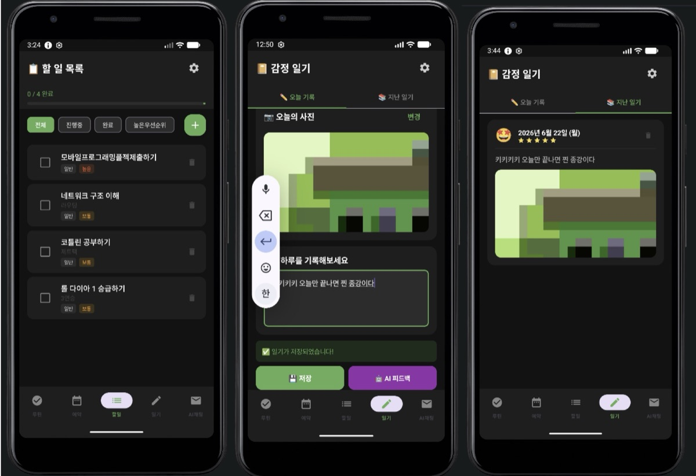
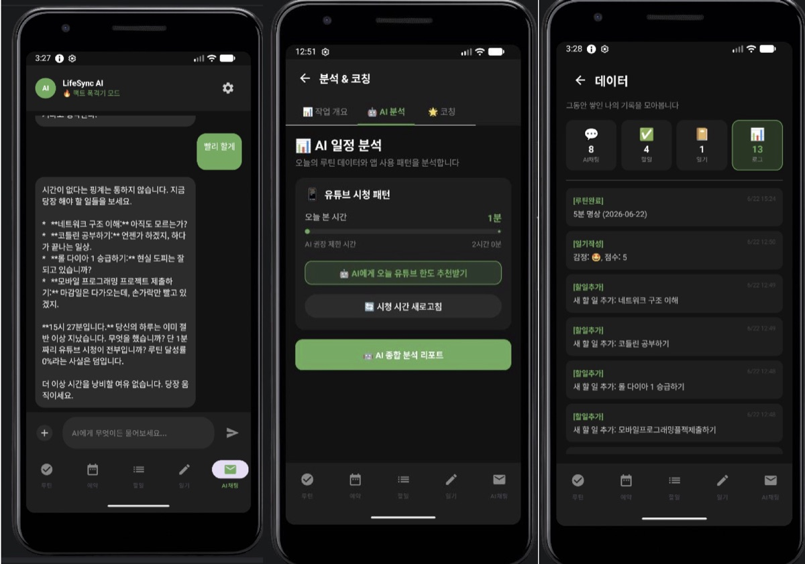

| 항목 | 내용 |
|---|---|
| 기간 | 2026년 6월 (최종 제출 2026년 6월 22일) |
| 상태 | 완료 (모바일프로그래밍 최종 프로젝트 제출) |
| 형태 | 개인 프로젝트 |
| 저장소 | [lifesync-android](https://github.com/Song-kyeong-chan/lifesync-android) · [lifesync-server](https://github.com/Song-kyeong-chan/lifesync-server) |
| 기술 | Kotlin, Jetpack Compose, Room, Retrofit2, Python, FastAPI, Gemini API, AWS EC2·S3 |

## 목적

집에 있을 때 침대에서 유튜브 쇼츠를 몇 시간씩 보고 있는 제 모습을 자주 발견했습니다.
이렇게 무의식적으로 흘려보내는 자투리 시간을 줄이고, 그 시간을 자기계발에 쓰도록 돕는 앱을 만들고 싶었습니다.

단순한 일정 관리에서 그치지 않고, 루틴·할 일·일기·앱 사용 기록을 한곳에 모은 뒤
AI가 패턴을 분석하고 정해진 시간에 스스로 피드백을 보내는 에이전트 구조를 목표로 했습니다.

## 맡은 역할

개인 프로젝트로, 기획부터 배포까지 모든 작업을 직접 했습니다.

- 기획: 문제 정의, MVP 범위 결정, ERD 설계
- 안드로이드 앱: 화면, 로컬 DB, 알림 예약, 서버 통신
- 서버: FastAPI로 AI 채팅·데이터 동기화·사진 업로드 API 구현
- 인프라: AWS EC2 서버 운영, S3 사진 저장소 연결
- 형상 관리: 앱과 서버를 각각 GitHub 저장소로 관리

## 수행 과정

1. **기획과 MVP 정하기**: 달력, 일간 할 일, 감정 일기, 오프라인 작동을 기본으로 두고, 일정 알림과 AI 피드백을 핵심 기능으로 정했습니다.
2. **데이터 구조 설계**: 사용자, 루틴, 루틴 완료 기록, 할 일, 일기, 예약 AI 작업, 활동 로그, 채팅 기록의 8개 테이블로 ERD를 만들고, 앱과 서버가 같은 구조를 쓰도록 했습니다.
3. **앱 화면과 로컬 DB 구현**: Jetpack Compose로 루틴·할 일·일기·AI 채팅·분석 화면을 만들고 Room에 저장했습니다. 코드는 기능별로 약 12개 Kotlin 파일로 나눴습니다.
4. **서버와 AI 연결**: FastAPI 서버가 Gemini API를 호출하고, 앱은 Retrofit2로 서버와 통신합니다.
5. **백그라운드 예약 브리핑**: AlarmManager로 알람을 등록하고, 알람이 울리면 BroadcastReceiver가 예약된 프롬프트를 서버로 보내 AI 응답을 알림으로 보여 줍니다. 기기를 재부팅해도 BootReceiver가 알람을 다시 등록합니다.
6. **사진 업로드와 배포**: 일기 사진은 서버가 발급한 presigned URL로 S3에 올리고, 서버는 EC2에서 실행했습니다.

## 기술 선택 이유

### 로컬 DB(Room)를 먼저 쓰고 서버에 동기화한 이유

MVP에 **오프라인 작동**을 넣었기 때문입니다.
루틴 체크나 일기 작성처럼 자주 하는 동작은 네트워크 없이 바로 저장되고,
AI 응답·사진 업로드·백업처럼 네트워크가 꼭 필요한 작업만 서버를 거치도록 나눴습니다.

### AI 호출을 앱이 아니라 서버에서 한 이유

AI API 키를 앱 안에 넣지 않고 서버의 환경변수에만 두기 위해서입니다.
개발 초기에 키를 코드에 직접 적었다가 노출된 적이 있어서, 그 키는 폐기하고 다시 발급한 뒤 환경변수로 분리했습니다.

## 결과물

할 일 목록, 감정 일기 작성 화면, 지난 일기 화면입니다. 일기에 사진을 붙이면 S3에 올라가고, 저장 후 AI 피드백을 요청할 수 있습니다.

AI 채팅, 분석과 코칭, 데이터 기록 화면입니다. AI 채팅에서는 루틴 달성률과 유튜브 시청 시간을 함께 전달해 상황에 맞는 답을 받고, 분석 화면에서는 오늘의 유튜브 시청 시간과 AI가 권장하는 한도를 보여 줍니다.

구현한 주요 기능은 다음과 같습니다.

| 기능 | 구현 내용 |
|---|---|
| 날짜별 루틴 관리 | 매일 반복 루틴과 특정 날짜 루틴을 구분하고, 주간 달력에서 날짜별 수행 기록 조회 |
| 할 일 관리 | 우선순위·카테고리별 정리, 완료율 표시, 필터 |
| 감정 일기 | 5단계 기분 점수와 사진 첨부, AI 피드백 요청 |
| AI 채팅 | 멘토·팩트·효율주의 3가지 페르소나 선택, 사진 분석 |
| 분석과 코칭 | UsageStatsManager로 유튜브 시청 시간 기록, 한도 초과 알림, 7일 루틴 그래프 |
| 예약 AI 브리핑 | 앱이 꺼져 있어도 정해진 시간에 AI 브리핑을 알림으로 전달 |

